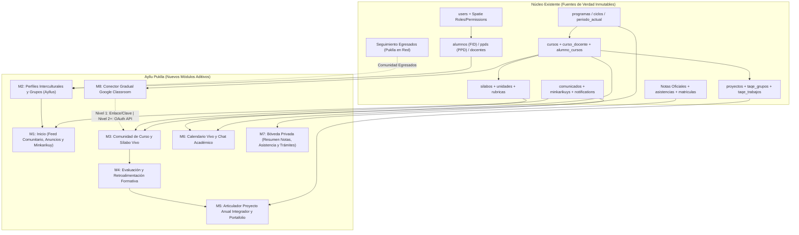
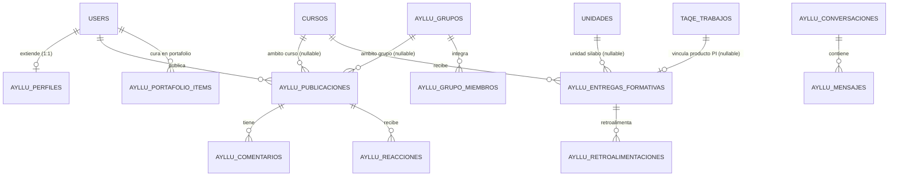
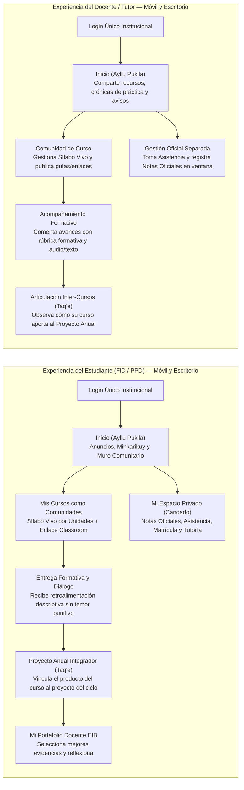

# Auditoría Técnica y Plan Maestro — Fase 0: **Ayllu Puklla**
**Un espacio para aprender y construir comunidad · EESP Pukllasunchis (Cusco)**

> [!IMPORTANT]
> **Estado de Ejecución: SOLO FASE 0 (Inspección no destructiva y Diseño de Arquitectura)**
> En cumplimiento estricto de las restricciones innegociables:
> 1. **No se ha modificado código ni base de datos.**
> 2. **Operaciones de cambio de rama en Git detenidas preventivamente (Restricción #3):** Se detectaron cambios sin confirmar del módulo de asistencias y tutoría en el árbol de trabajo actual sobre la rama `sistemadeseguimientodeegresados`. No se ejecutó `git checkout -b feature/ayllu-puklla` hasta recibir tu instrucción sobre cómo resguardar esos archivos.
> 3. **Verificación de documentos adjuntos:** Se localizó [INICIO_ANTIGRAVITY.md](file:///Users/pavelchaparro/Downloads/INICIO_ANTIGRAVITY.md) en `Downloads/`, así como la documentación existente en [docs/seguimiento-egresados/](file:///Users/pavelchaparro/.gemini/antigravity/scratch/Pukllasunchis/docs/seguimiento-egresados/00-auditoria-repositorio.md) y [DOCUMENTACION-TECNICA-SISTEMA.md](file:///Users/pavelchaparro/.gemini/antigravity/scratch/Pukllasunchis/DOCUMENTACION-TECNICA-SISTEMA.md). No se encontró un archivo `AGENTS.md` específico de **Ayllu Puklla** dentro del repositorio `/Users/pavelchaparro/.gemini/antigravity/scratch/Pukllasunchis` (solo existen `.agents/skills/` de GSAP y `.claude/`). Si dispones de un paquete zip adicional con `AGENTS.md` y documentos nuevos de `docs/` para Ayllu Puklla, indícanos su ruta para incorporarlos antes de iniciar la Fase 1.

---

## 1. Informe de Auditoría con Evidencia Concreta (Tareas A, B y C)

### A. Estado de Git, Stack y Arquitectura Actual

* **Ruta del repositorio local:** `/Users/pavelchaparro/.gemini/antigravity/scratch/Pukllasunchis`
* **Remoto Git:** `origin` → `https://github.com/JesusDjm2/Pukllasunchis.git`
* **Rama activa:** `sistemadeseguimientodeegresados` (HEAD en `ecda55d`: *feat(seguimiento-egresados): gestion de campanas, asignacion equilibrada de docentes reales y monitoreo territorial*).
* **Otras ramas detectadas:** Locales: `main`, `seguimientoesp`. Remotas: `origin/main`, `origin/master`, `origin/feature/mobile-api`, `origin/feature/titulacion`.
* **Árbol de trabajo sucio (Motivo de pausa de Git según Restricción #3):**
  * **Modificados (sin stage):**
    * [TutorController.php](file:///Users/pavelchaparro/.gemini/antigravity/scratch/Pukllasunchis/app/Http/Controllers/TutorController.php)
    * [ciclo.blade.php](file:///Users/pavelchaparro/.gemini/antigravity/scratch/Pukllasunchis/resources/views/tutor/ciclo.blade.php)
    * [index.blade.php](file:///Users/pavelchaparro/.gemini/antigravity/scratch/Pukllasunchis/resources/views/tutor/index.blade.php)
    * [admin.php](file:///Users/pavelchaparro/.gemini/antigravity/scratch/Pukllasunchis/routes/admin.php)
  * **No rastreados (Untracked — Módulo de Asistencias en progreso):**
    * [AsistenciaAdminController.php](file:///Users/pavelchaparro/.gemini/antigravity/scratch/Pukllasunchis/app/Http/Controllers/AsistenciaAdminController.php)
    * [DocenteAsistenciaController.php](file:///Users/pavelchaparro/.gemini/antigravity/scratch/Pukllasunchis/app/Http/Controllers/DocenteAsistenciaController.php)
    * [Asistencia.php](file:///Users/pavelchaparro/.gemini/antigravity/scratch/Pukllasunchis/app/Models/Asistencia.php) y [AsistenciaDetalle.php](file:///Users/pavelchaparro/.gemini/antigravity/scratch/Pukllasunchis/app/Models/AsistenciaDetalle.php)
    * [AsistenciaService.php](file:///Users/pavelchaparro/.gemini/antigravity/scratch/Pukllasunchis/app/Services/AsistenciaService.php)
    * [2026_10_29_170000_create_asistencias_tables.php](file:///Users/pavelchaparro/.gemini/antigravity/scratch/Pukllasunchis/database/migrations/2026_10_29_170000_create_asistencias_tables.php)
    * Vistas en `resources/views/admin/asistencias/`, `resources/views/docentes/asistencia/` y `resources/views/tutor/partials/asistencia.blade.php`.
* **Stack Tecnológico Verificado:**
  * **PHP:** `8.2.32 (cli)`
  * **Framework:** `Laravel Framework 10.50.2` ([composer.json](file:///Users/pavelchaparro/.gemini/antigravity/scratch/Pukllasunchis/composer.json))
  * **Paquetes clave instalados:**
    * `spatie/laravel-permission: ^6.3` (Roles y permisos granulares en guard `web`).
    * `laravel/sanctum: ^3.3` (Instalado, tabla `personal_access_tokens` creada, aún sin emisión de tokens móviles).
    * `google/apiclient: ^2.15` (Usado exclusivamente en [GoogleDriveService.php](file:///Users/pavelchaparro/.gemini/antigravity/scratch/Pukllasunchis/app/Services/GoogleDriveService.php) para subir/streamear archivos de Cursos Especiales y Taq'e; **no está conectado a Google Classroom API**).
    * `barryvdh/laravel-dompdf: ^3.1`, `maatwebsite/excel: ^3.1.58`, `simplesoftwareio/simple-qrcode: ^4.2`.
  * **Frontend Actual:**
    * Plantillas **Blade** con **Bootstrap 4 (SB Admin 2)** (`public/admin/css/sb-admin-2.min.css`), jQuery, FontAwesome 5, SweetAlert2 y CKEditor 4.9.2.
    * Sistema de tokens CSS institucionales en [pk-tokens.css](file:///Users/pavelchaparro/.gemini/antigravity/scratch/Pukllasunchis/public/css/pk-tokens.css) (`--pk-oro: #cd9244`, `--pk-marron: #9c6b37`, `--pk-crema: #f6d39c`, `--pk-petroleo: #33445a`) y menú lateral unificado en `public/css/pk-sidebar.css` con soporte de modo claro, tenue (`dim-mode`) y oscuro (`dark-mode`).
  * **Enrutamiento:** Dividido principalmente entre [routes/web.php](file:///Users/pavelchaparro/.gemini/antigravity/scratch/Pukllasunchis/routes/web.php) (sitio público, formularios QR, seguimiento de egresados) y [routes/admin.php](file:///Users/pavelchaparro/.gemini/antigravity/scratch/Pukllasunchis/routes/admin.php) (autenticación e intranet completa de alumnos FID/PPD, docentes, tutores, Taq'e, titulación y administración), además de [routes/pukllabot.php](file:///Users/pavelchaparro/.gemini/antigravity/scratch/Pukllasunchis/routes/pukllabot.php).

---

### B. Identificación de Dominios y Módulos Existentes

1. **Autenticación y Usuarios ([User.php](file:///Users/pavelchaparro/.gemini/antigravity/scratch/Pukllasunchis/app/Models/User.php)):**
   * Tabla única `users` como fuente maestra de identidad institucional (`id`, `name`, `apellidos`, `dni`, `email`, `foto`, `condicion`, `perfil`, `beca`, `genero`, `etnicoidad`, `lengua_1`, `lengua_2`, `domicilio`, `telefono`, `whatsapp_key`, `programa_id`, `ciclo_id`).
   * Sincronización automática bidireccional entre `User` y `Alumno` mediante `App\Services\SincronizarFicha` y registro automático de hitos en `trayectoria_eventos` mediante `App\Services\Trayectoria`.
2. **Roles y Permisos Spatie:**
   * Guard `web`. Roles verificados en migraciones y base de datos:
     * `super-admin`, `admin`, `adminB` (Bolsa/PPD)
     * `docente` (50+ cuentas), `tutor` (asignado por ciclo en tabla `tutor_ciclos`), `investigador` (seguimiento Taq'e), `gestor-titulacion`
     * `alumno` (estudiante FID), `alumnoB` (estudiante PPD), `inhabilitado`
     * Roles recientes de Seguimiento de Egresados ([2026_10_31_100000_create_seguimiento_egresados_role_and_permissions.php](file:///Users/pavelchaparro/.gemini/antigravity/scratch/Pukllasunchis/database/migrations/2026_10_31_100000_create_seguimiento_egresados_role_and_permissions.php)): `seguimiento-egresados`, `coordinacion-empleabilidad`, `direccion`, más 10 permisos granulares (`seguimiento-egresados.*`).
3. **Perfiles de Estudiante (Doble flujo FID / PPD) y Docente:**
   * **FID:** Modelo [Alumno.php](file:///Users/pavelchaparro/.gemini/antigravity/scratch/Pukllasunchis/app/Models/Alumno.php) (`alumnos`, relación 1:1 con `users`), incluye ficha socioeconómica, cultural y lingüística (`lengua_1`, `lengua_2`, `te_consideras`, `procedencia_familiar`, `habilidades`). Layout: [layouts/alumno.blade.php](file:///Users/pavelchaparro/.gemini/antigravity/scratch/Pukllasunchis/resources/views/layouts/alumno.blade.php).
   * **PPD:** Modelo [ppd.php](file:///Users/pavelchaparro/.gemini/antigravity/scratch/Pukllasunchis/app/Models/ppd.php) (`ppds`, relación 1:1 con `users` vía `alumnoB()`). Layout: [layouts/profesionalizacion.blade.php](file:///Users/pavelchaparro/.gemini/antigravity/scratch/Pukllasunchis/resources/views/layouts/profesionalizacion.blade.php).
   * **Egresados:** `users.condicion === 'Egresado'`, con portal propio en [EgresadoIntranetController.php](file:///Users/pavelchaparro/.gemini/antigravity/scratch/Pukllasunchis/app/Http/Controllers/EgresadoIntranetController.php) y vista [egresado/intranet.blade.php](file:///Users/pavelchaparro/.gemini/antigravity/scratch/Pukllasunchis/resources/views/egresado/intranet.blade.php).
   * **Docente:** Modelo [Docente.php](file:///Users/pavelchaparro/.gemini/antigravity/scratch/Pukllasunchis/app/Models/Docente.php) (`docentes`, relación 1:1 con `users`), campos `nombre`, `foto`, `dni`, `email`, `telefono`, `descripcion`, `blog`. Layout: [layouts/docente.blade.php](file:///Users/pavelchaparro/.gemini/antigravity/scratch/Pukllasunchis/resources/views/layouts/docente.blade.php).
4. **Matrícula y Períodos Académicos:**
   * FID: [PeriodoActual.php](file:///Users/pavelchaparro/.gemini/antigravity/scratch/Pukllasunchis/app/Models/PeriodoActual.php) (`periodo_actual`) y [Matricula.php](file:///Users/pavelchaparro/.gemini/antigravity/scratch/Pukllasunchis/app/Models/Matricula.php) (`matriculas`, con subida y verificación de voucher). Asignación de cursos extra/cargo en `alumno_cursos` (con `periodo_actual_id`).
   * PPD: [PeriodoActualPpd.php](file:///Users/pavelchaparro/.gemini/antigravity/scratch/Pukllasunchis/app/Models/PeriodoActualPpd.php) (`periodo_actual_ppds`) y [MatriculaPpd.php](file:///Users/pavelchaparro/.gemini/antigravity/scratch/Pukllasunchis/app/Models/MatriculaPpd.php) (`matriculas_ppd`).
5. **Cursos, Sílabos y Proyectos Integradores (Taq'e):**
   * [Curso.php](file:///Users/pavelchaparro/.gemini/antigravity/scratch/Pukllasunchis/app/Models/Curso.php) (`cursos`): vinculado a `ciclos` (`ciclo_id`), a docentes (`curso_docente`) y a competencias (`competencia_curso`, `curso_competencia_seleccionada`).
   * **Estado real de Google Classroom (Restricción #5):** En `cursos` solo existen dos columnas de texto (`classroom` para URL/enlace y `clave` para código de clase), editables manualmente vía `CursoController::classroomClaveCRUD`. **No existe integración OAuth ni sincronización con Google Classroom API.**
   * [Silabo.php](file:///Users/pavelchaparro/.gemini/antigravity/scratch/Pukllasunchis/app/Models/Silabo.php) (`silabos`): contiene `sumilla`, `proyecto_integrador`, `producto_proyecto_integrador`, `vinculacion_pi`, `producto_curso`, 3 bloques de `capacidad/desempeno/criterio/evidencia/instrumento`, `organizacion`, `modelos_metodologicos`, `recursos`, `referencias`, y tablas hijas `enfoque_silabos`, `unidades` ([Unidades.php](file:///Users/pavelchaparro/.gemini/antigravity/scratch/Pukllasunchis/app/Models/Unidades.php)) y `rubricas` ([Rubricas.php](file:///Users/pavelchaparro/.gemini/antigravity/scratch/Pukllasunchis/app/Models/Rubricas.php)), además de `silabo_pdf`.
   * **Proyecto Anual Integrador y Taq'e:** Ya existe una base valiosa en el repositorio:
     * [Proyecto.php](file:///Users/pavelchaparro/.gemini/antigravity/scratch/Pukllasunchis/app/Models/Proyecto.php) (`proyectos`, vinculado a `ciclos.proyecto_id` y a docentes encargados/organizadores en `proyecto_docente`).
     * [TaqeGrupo.php](file:///Users/pavelchaparro/.gemini/antigravity/scratch/Pukllasunchis/app/Models/TaqeGrupo.php) (`taqe_grupos` y pivot `taqe_grupo_alumno`), [TaqeTrabajo.php](file:///Users/pavelchaparro/.gemini/antigravity/scratch/Pukllasunchis/app/Models/TaqeTrabajo.php) (`taqe_trabajos`, que distingue `categoria = 'evidencia'` de `categoria = 'final'` y soporta archivos en Google Drive o enlaces externos) y [TaqeSolicitudAyuda.php](file:///Users/pavelchaparro/.gemini/antigravity/scratch/Pukllasunchis/app/Models/TaqeSolicitudAyuda.php).
6. **Notas Académicas Oficiales (Restricción #6):**
   * **FID:** Flujo oficial en [Calificacion.php](file:///Users/pavelchaparro/.gemini/antigravity/scratch/Pukllasunchis/app/Models/Calificacion.php) (`calificacions`), [PeriodoUno.php](file:///Users/pavelchaparro/.gemini/antigravity/scratch/Pukllasunchis/app/Models/PeriodoUno.php) (`periodouno`), [PeriodoDos.php](file:///Users/pavelchaparro/.gemini/antigravity/scratch/Pukllasunchis/app/Models/PeriodoDos.php) (`periodo_dos`), [PeriodoTres.php](file:///Users/pavelchaparro/.gemini/antigravity/scratch/Pukllasunchis/app/Models/PeriodoTres.php) (`periodo_tres`), `periodo_parciales` y archivo histórico cerrado en [Periodo.php](file:///Users/pavelchaparro/.gemini/antigravity/scratch/Pukllasunchis/app/Models/Periodo.php) (`periodos`), además de tablas de actas históricas `rp_*`.
   * **PPD:** Flujo oficial en [Calificacionesppd.php](file:///Users/pavelchaparro/.gemini/antigravity/scratch/Pukllasunchis/app/Models/Calificacionesppd.php) (`calificacionesppds`) y snapshot histórico en [PeriodoPpd.php](file:///Users/pavelchaparro/.gemini/antigravity/scratch/Pukllasunchis/app/Models/PeriodoPpd.php) (`periodo_ppds`).
   * **No existe un sub-módulo separado de evaluación/retroalimentación formativa continua** (comentarios pedagógicos dialogados sobre avances sin alterar las actas oficiales).
7. **Asistencia:**
   * [Asistencia.php](file:///Users/pavelchaparro/.gemini/antigravity/scratch/Pukllasunchis/app/Models/Asistencia.php) (`asistencias`) y [AsistenciaDetalle.php](file:///Users/pavelchaparro/.gemini/antigravity/scratch/Pukllasunchis/app/Models/AsistenciaDetalle.php) (`asistencia_detalles`), con servicio en [AsistenciaService.php](file:///Users/pavelchaparro/.gemini/antigravity/scratch/Pukllasunchis/app/Services/AsistenciaService.php). Permite a docentes tomar asistencia por sesión/fecha y a tutores/administradores monitorearla (actualmente sin confirmar en Git).
8. **Noticias, Anuncios, Eventos y Notificaciones:**
   * [Comunicado.php](file:///Users/pavelchaparro/.gemini/antigravity/scratch/Pukllasunchis/app/Models/Comunicado.php) (`comunicados`: título, descripción, imagen/PDF, fecha).
   * [Minkarikuy.php](file:///Users/pavelchaparro/.gemini/antigravity/scratch/Pukllasunchis/app/Models/Minkarikuy.php) (`minkarikuys`: eventos institucionales con fecha, hora, enlace y generación de QR).
   * Tabla `notifications` nativa de Laravel + campana en topbar ([notificaciones-dropdown.blade.php](file:///Users/pavelchaparro/.gemini/antigravity/scratch/Pukllasunchis/resources/views/docentes/partials/notificaciones-dropdown.blade.php)) + envíos de mensajes de docente a curso (`DocenteCOntroller::enviarMensajeCurso`) y de tutor a ciclo (`TutorController::enviarMensaje`).
9. **Recursos, LMS Asincrónico y Chatbot:**
   * Cursos Especiales (`cursos_especiales`, `ce_niveles`, `ce_unidades`, `ce_lecciones`, `ce_ejercicios`, `ce_inscripciones`, `ce_progreso_alumno`) enfocado inicialmente en Quechua.
   * Chatbot institucional `PukllaBot` (`knowledge_chunks`, [PukllaBotChatController.php](file:///Users/pavelchaparro/.gemini/antigravity/scratch/Pukllasunchis/app/Http/Controllers/PukllaBotChatController.php)).
10. **Calendario:**
    * Actualmente **no existe un calendario interactivo de eventos/hitos**; `periodo_actual.horario` y `periodo_actual_ppds.calendario` almacenan únicamente la ruta de una **imagen estática** que se abre en un modal (`#modalHorario` / `#modalCalendarioPpd`), aunque `periodo_actual` sí tiene columnas `fecha_inicio`, `fecha_cierre` y ventanas de parciales, y `minkarikuys` tiene `fecha` y `hora`.
11. **Módulo de Seguimiento de Egresados («Puklla en Red»):**
    * Consolidado en la rama actual con 10 modelos en `app/Models/SeguimientoEgresado/` (`Campana`, `AsignacionCampana`, `GrupoEntrevistador`, `Actualizacion`, `EpisodioLaboral`, `Caso`, `Llamada`, `InvitacionCampana`, `AccesoContacto`, `AuditoriaRolSeguimiento`).

---

### C. Inspección No Destructiva del Esquema de Base de Datos (`puklla`)

* Se verificó el directorio de datos local `/Users/pavelchaparro/.local/mysql/data/puklla` y las **142 migraciones** en `database/migrations/`.
* **Nota operativa de entorno:** El proceso demonio de MySQL no estaba corriendo en segundo plano al momento del comando CLI (`Connection refused` en socket), pero los **120 archivos de tablas InnoDB (`.ibd`)** de la base `puklla` están íntegros en `/Users/pavelchaparro/.local/mysql/data/puklla` (actualizados hasta el 31 de octubre de 2026 a las 12:27 PM, incluyendo `asistencias`, `asistencia_detalles` y todas las tablas de `egresado_*` y `taqe_*`).

---

## 2. Matriz «Reutilizar / Adaptar / Crear / No confirmado» (Tarea D)

| Dominio / Componente | Acción | Evidencia verificada (Archivos / Tablas) | Cómo se integra en **Ayllu Puklla** |
|---|---|---|---|
| **Identidad y Autenticación** | **REUTILIZAR** | [User.php](file:///Users/pavelchaparro/.gemini/antigravity/scratch/Pukllasunchis/app/Models/User.php), tabla `users`, `sessions`, `bitacora_sesiones` | Fuente única de identidad para estudiantes FID, PPD, docentes, tutores, egresados y admin. Cero duplicación de usuarios. |
| **Roles y Permisos** | **REUTILIZAR** | `spatie/laravel-permission`, tablas `roles`, `permissions`, `model_has_roles` | Se mantienen todos los roles actuales y se añaden solo permisos granulares `ayllu.*` asignados a los roles existentes (`alumno`, `alumnoB`, `docente`, `tutor`, `admin`, `super-admin`). |
| **Perfiles Estudiante (FID/PPD) y Docente** | **ADAPTAR (Aditivo)** | [Alumno.php](file:///Users/pavelchaparro/.gemini/antigravity/scratch/Pukllasunchis/app/Models/Alumno.php) (`alumnos`), [ppd.php](file:///Users/pavelchaparro/.gemini/antigravity/scratch/Pukllasunchis/app/Models/ppd.php) (`ppds`), [Docente.php](file:///Users/pavelchaparro/.gemini/antigravity/scratch/Pukllasunchis/app/Models/Docente.php) (`docentes`) | Reutilizar datos lingüísticos (`lengua_1`, `lengua_2`), programa, ciclo y foto; añadir tabla/preferencias de perfil comunitario (`ayllu_perfiles`: bio breve, saberes/intereses, saludo en quechua/lengua originaria, privacidad). |
| **Menú y Layouts de Intranet** | **ADAPTAR** | [layouts/alumno.blade.php](file:///Users/pavelchaparro/.gemini/antigravity/scratch/Pukllasunchis/resources/views/layouts/alumno.blade.php), [layouts/docente.blade.php](file:///Users/pavelchaparro/.gemini/antigravity/scratch/Pukllasunchis/resources/views/layouts/docente.blade.php), [layouts/profesionalizacion.blade.php](file:///Users/pavelchaparro/.gemini/antigravity/scratch/Pukllasunchis/resources/views/layouts/profesionalizacion.blade.php), [pk-tokens.css](file:///Users/pavelchaparro/.gemini/antigravity/scratch/Pukllasunchis/public/css/pk-tokens.css) | Incorporar el ítem inicial provisional **«Inicio»** (marca **Ayllu Puklla**) como punto de entrada comunitario cálido y barra inferior móvil (*bottom nav*), manteniendo intactos los menús académicos actuales. |
| **Comunicados y Eventos Minkarikuy** | **REUTILIZAR / ADAPTAR** | [Comunicado.php](file:///Users/pavelchaparro/.gemini/antigravity/scratch/Pukllasunchis/app/Models/Comunicado.php) (`comunicados`), [Minkarikuy.php](file:///Users/pavelchaparro/.gemini/antigravity/scratch/Pukllasunchis/app/Models/Minkarikuy.php) (`minkarikuys`) | Se consumen directamente en el feed de **«Inicio»** de Ayllu Puklla como anuncios oficiales destacados y eventos comunitarios sin duplicar tablas. |
| **Muro Comunitario, Publicaciones y Reacciones** | **CREAR** | *No existe en BD actual* | Nuevas tablas aditivas `ayllu_publicaciones`, `ayllu_comentarios`, `ayllu_reacciones` (con soporte bilingüe castellano/quechua, etiquetas de saber y ámbito: institucional, programa, ciclo, curso o grupo). |
| **Grupos / Ayllus Temáticos y Tutoría** | **ADAPTAR / CREAR** | `tutor_ciclos`, [TaqeGrupo.php](file:///Users/pavelchaparro/.gemini/antigravity/scratch/Pukllasunchis/app/Models/TaqeGrupo.php) (`taqe_grupos`) | Reutilizar pertenencia a ciclos, tutorías y grupos Taq'e; crear `ayllu_grupos` y `ayllu_grupo_miembros` para círculos de estudio, talleres («Viernes Puklla», Ayarachi, Quechua) y comunidades inter-ciclo. |
| **Cursos como Comunidades y Sílabo Vivo** | **ADAPTAR** | [Curso.php](file:///Users/pavelchaparro/.gemini/antigravity/scratch/Pukllasunchis/app/Models/Curso.php) (`cursos`), [Silabo.php](file:///Users/pavelchaparro/.gemini/antigravity/scratch/Pukllasunchis/app/Models/Silabo.php) (`silabos`, `unidades`, `rubricas`) | Envolver el curso actual (`cursos`) y su sílabo (`silabos` + `unidades` + `rubricas`) en una vista de **Comunidad de Curso** donde cada unidad del sílabo muestra su progreso vivo, recursos, diálogo y productos vinculados al Proyecto Integrador. |
| **Evaluación y Retroalimentación Formativa** | **CREAR (Separado de Notas Oficiales)** | *No existe como módulo formativo continuo* | Crear tablas aditivas `ayllu_entregas_formativas` y `ayllu_retroalimentaciones` vinculadas a `cursos`, `unidades` y `rubricas`. **Separadas estrictamente** de `calificacions`, `periodouno/dos/tres` y `calificacionesppds`. |
| **Notas Académicas Oficiales** | **REUTILIZAR (Intocable en muro)** | `calificacions`, `periodouno`, `periodo_dos`, `periodo_tres`, `periodos`, `calificacionesppds`, `periodo_ppds` | Se mantienen 100% privadas en su flujo oficial ([CalificacionController.php](file:///Users/pavelchaparro/.gemini/antigravity/scratch/Pukllasunchis/app/Http/Controllers/CalificacionController.php)). En Ayllu Puklla el alumno solo ve un acceso privado a «Mis Notas / Asistencia / Trámites». |
| **Proyecto Anual Integrador y Productos** | **REUTILIZAR / ADAPTAR** | [Proyecto.php](file:///Users/pavelchaparro/.gemini/antigravity/scratch/Pukllasunchis/app/Models/Proyecto.php) (`proyectos`), [TaqeGrupo.php](file:///Users/pavelchaparro/.gemini/antigravity/scratch/Pukllasunchis/app/Models/TaqeGrupo.php) (`taqe_grupos`), [TaqeTrabajo.php](file:///Users/pavelchaparro/.gemini/antigravity/scratch/Pukllasunchis/app/Models/TaqeTrabajo.php) (`taqe_trabajos`) | Conectar los productos de curso (`silabos.producto_curso` y entregas formativas) con `taqe_trabajos` (`evidencia` / `final`) y `proyectos`, permitiendo articular los aportes de cada curso al Proyecto Anual Integrador. |
| **Portafolio Docente en Formación** | **CREAR (Sobre Taq'e y Entregas)** | Reutiliza `taqe_trabajos` y [GoogleDriveService.php](file:///Users/pavelchaparro/.gemini/antigravity/scratch/Pukllasunchis/app/Services/GoogleDriveService.php) | Crear `ayllu_portafolio_items` que permita al estudiante curar evidencias de `taqe_trabajos` y `ayllu_entregas_formativas` a lo largo de sus 10 ciclos (FID) o PPD, con reflexión pedagógica EIB. |
| **Asistencia y Trámites Privados** | **REUTILIZAR** | [Asistencia.php](file:///Users/pavelchaparro/.gemini/antigravity/scratch/Pukllasunchis/app/Models/Asistencia.php) (`asistencias`), `matriculas`, `tutorias`, `sugerencias`, `incidencias`, `expediente_documentos` | Integrar como widgets/accesos estrictamente privados del estudiante y docente. Confirmar primero el commit de los archivos de `Asistencia` que están untracked en Git. |
| **Calendario Académico y Comunitario** | **ADAPTAR / CREAR** | `periodo_actual` (fechas de parciales/inicio/cierre), `minkarikuys` (fechas de eventos), `tutorias` | Crear vista unificada de Calendario Vivo + tabla aditiva `ayllu_eventos_calendario` que agregue automáticamente fechas de `periodo_actual`, `minkarikuys`, entregas de sílabo/Taq'e y tutorías, manteniendo el horario en imagen como pestaña complementaria. |
| **Chat Académico / Comunitario** | **CREAR** | `notifications` (reutilizable para avisos) | Crear `ayllu_conversaciones`, `ayllu_conversacion_participantes` y `ayllu_mensajes` (polling ligero AJAX sobre sesión web en MVP, sin requerir servidor WebSockets externo). |
| **Integración con Google Classroom** | **NO CONFIRMADO / ADAPTAR GRADUAL** | `cursos.classroom` y `cursos.clave` (solo texto manual); `google/apiclient` solo tiene scopes de Drive | **No existe conexión OAuth con Classroom.** Se propone integración en 3 niveles graduales: Nivel 1 (MVP): deep-links y código de clase desde `cursos.classroom`/`clave`; Nivel 2: vinculación OAuth `ClassroomService` de solo lectura (cursos/anuncios/tareas); Nivel 3: importación opcional de entregas como evidencias formativas. |
| **Documentos adjuntos `AGENTS.md` de Ayllu Puklla** | **NO CONFIRMADO** | Solo se halló `INICIO_ANTIGRAVITY.md` en `Downloads/` | Confirmar con el usuario si existe un archivo `AGENTS.md` adicional por copiar a la raíz del repositorio. |

---

## 3. Arquitectura de Módulos, Relaciones, Políticas, Rutas y Alcance del MVP (Tarea E)

### 3.1. Principio Rector: Separación de Tres Capas de Información (Restricción #6)

Para proteger la validez legal y el clima comunitario de la EESP Pukllasunchis, **Ayllu Puklla** separa a nivel de base de datos, controladores, políticas y diseño visual tres planos que nunca se mezclan:

| Plano | Propósito Pedagógico | Tablas Fuente de Verdad | Visibilidad y Acceso |
|---|---|---|---|
| **1. Social y Comunitario** | Crianza mutua, diálogo de saberes, anuncios (`Comunicado`, `Minkarikuy`), preguntas, hallazgos de práctica EIB y vida en comunidad. | `comunicados`, `minkarikuys`, `ayllu_publicaciones`, `ayllu_comentarios`, `ayllu_reacciones`, `ayllu_grupos` | Visible para los miembros del ámbito elegido (Toda la EESP, Programa, Ciclo, Comunidad de Curso o Grupo). **Nunca otorga nota.** |
| **2. Evaluación y Retroalimentación Formativa** | Acompañamiento continuo del docente y co-evaluación sobre avances del sílabo vivo y del Proyecto Integrador (Taq'e). | `silabos`, `unidades`, `rubricas`, `taqe_grupos`, `taqe_trabajos`, `ayllu_entregas_formativas`, `ayllu_retroalimentaciones` | Privado entre el estudiante (o su equipo `TaqeGrupo`), el docente del curso y encargados del Proyecto Integrador. Usa valoraciones descriptivas y rúbricas formativas; **no modifica actas oficiales**. |
| **3. Notas, Asistencia y Trámites Oficiales** | Registro académico oficial auditable (Parcial 1, Parcial 2, Desempeño, Actas, Vouchers de Matrícula, Asistencia oficial). | `calificacions`, `periodouno`, `periodo_dos`, `periodo_tres`, `periodos`, `calificacionesppds`, `periodo_ppds`, `asistencias`, `matriculas` | **Estrictamente privado e individual.** Solo el estudiante titular, el docente calificador titular y Administración (`admin`/`super-admin`) según ventanas de `PeriodoActual`. |

---

### 3.2. Diagrama Lógico de Dependencias de Módulos (Entregable 3)

---

### 3.3. Modelo Relacional Aditivo Propuesto (Sin tocar tablas existentes)

---

### 3.4. Políticas de Acceso (Laravel Policies + Spatie Permissions)

1. **`AylluPublicacionPolicy`:**
   * *Ver:* Usuario autenticado sin rol `inhabilitado` que pertenezca al ámbito de la publicación (`global`, `programa_id`, `ciclo_id`, `curso_id` donde está matriculado o es docente, o `ayllu_grupo_id` donde es miembro).
   * *Crear/Editar/Eliminar:* Autor de la publicación; moderación institucional habilitada para `docente` (en su curso), `tutor` (en su ciclo) y `admin`/`super-admin`.
2. **`AylluCursoComunidadPolicy`:**
   * *Acceso a la comunidad del curso:* Estudiante matriculado en el curso (`Curso::alumnosValidosIds()` para FID o universo del programa en PPD), docente asignado en `curso_docente`, tutor del ciclo (`tutor_ciclos`) o `admin`/`super-admin`.
3. **`AylluEvaluacionFormativaPolicy`:**
   * *Ver entrega y retroalimentación formativa:* Exclusivamente el estudiante autor (o miembros aceptados de su `TaqeGrupo` si es grupal) y el docente titular del curso (`curso_docente`). Ningún otro estudiante puede ver retroalimentaciones formativas individuales ajenas.
4. **`BovedaPrivadaPolicy` (Notas / Asistencia / Trámites):**
   * Reutiliza estrictamente las verificaciones de propiedad (`auth()->id() === $alumno->user_id`) y las ventanas de publicación de [PeriodoActual.php](file:///Users/pavelchaparro/.gemini/antigravity/scratch/Pukllasunchis/app/Models/PeriodoActual.php) (`parcial1Visible()`, `parcial2DesempenoVisible()`).

---

### 3.5. Rutas Principales Propuestas (Prefijo `/ayllu`, menú provisional «Inicio»)

Todas bajo `middleware(['auth'])` y verificación de cuenta activa (no `inhabilitado`):

* `GET /inicio` (alias `route('ayllu.inicio')`) → **Inicio (Ayllu Puklla)**: Feed comunitario cálido, comunicados oficiales, eventos `Minkarikuy`, accesos rápidos a mis cursos, mi proyecto anual integrador y resumen privado.
* `GET /ayllu/perfil/{user?}` → Perfil intercultural del estudiante/docente/egresado y pestaña de **Mi Portafolio**.
* `GET /ayllu/grupos` y `GET /ayllu/grupos/{grupo}` → Comunidades y círculos de aprendizaje (Quechua, Viernes Puklla, Tutoría de Ciclo, Investigación).
* `GET /ayllu/cursos/{curso}` → **Comunidad del Curso**:
  * Pestaña *Muro y Recursos del Curso* (con tarjeta de acceso rápido/sincronización gradual a Google Classroom).
  * Pestaña *Sílabo Vivo* (unidades de `silabos` + `unidades` + `rubricas` interactivas).
  * Pestaña *Evaluación Formativa* (entregas de proceso, diálogo pedagógico con el docente, autoevaluación/coevaluación).
  * Pestaña *Aporte al Proyecto Integrador* (conexión directa con `Proyecto` y `TaqeGrupo` / `TaqeTrabajo`).
* `GET /ayllu/proyecto-integrador` → Vista articuladora del **Proyecto Anual Integrador** donde confluyen los productos de todos los cursos del ciclo hacia el grupo Taq'e.
* `GET /ayllu/calendario` → Calendario comunitario y académico unificado.
* `GET /ayllu/chat` → Mensajería académica directa y por curso/grupo.
* `GET /ayllu/mi-espacio-privado` → Hub privado que enlaza sin duplicar a: Calificaciones oficiales (`route('calificaciones')` / `route('calificacionesppd')`), Mi Asistencia, Matrícula/Voucher y Tutoría individual.

---

### 3.6. Alcance Preciso del MVP (Fase 1) vs. Fases Posteriores

* **Incluido en el MVP (Fase 1):**
  1. Menú provisional **«Inicio»** en los layouts de Estudiante FID, Estudiante PPD, Docente y Egresado con identidad visual cálida **Ayllu Puklla** y navegación inferior móvil (*bottom bar*).
  2. **Inicio Comunitario**: Publicaciones (con etiquetas pedagógicas/interculturales y soporte quechua–castellano), comentarios, reacciones cálidas (ej. *Allinmi / Ayni / Yachay*), e integración nativa de `Comunicado` y `Minkarikuy`.
  3. **Comunidad de Curso + Sílabo Vivo**: Vista comunitaria de cada `Curso` real leyendo su `Silabo`, `Unidades`, `Rubricas` y el enlace/clave de Google Classroom (`cursos.classroom` / `cursos.clave`).
  4. **Evaluación Formativa y Articulación con Proyecto Integrador (Taq'e)**: Entregas formativas por unidad/curso, retroalimentación dialogada del docente y botón para promover un producto de curso como evidencia o trabajo final de `TaqeTrabajo`.
  5. **Calendario Vivo y Bóveda Privada**: Consolidación de fechas de `PeriodoActual` + `Minkarikuy` y panel privado de acceso a Notas Oficiales, Asistencia y Trámites.
* **Para Fase 2 y Fase 3 (Post-MVP):**
  * Portafolio longitudinal exportable (PDF/Web) y curaduría de evidencias multi-ciclo.
  * Chat académico interactivo en tiempo real/polling y Grupos temáticos autogestionados.
  * Integración OAuth2 con Google Classroom API (`ClassroomService` de solo lectura/importación de tareas).

---

## 4. Mapa de Experiencia de Estudiante y Docente (Entregable 2)

---

## 5. Propuesta de Prototipos Navegables Móvil/Escritorio (Tarea F)

Para validar la experiencia antes de escribir migraciones definitivas, proponemos construir en la **Fase 0.5 / Inicio de Fase 1** un **Prototipo Navegable Responsivo (Móvil + Escritorio)** integrado en el entorno local de Laravel (`/ayllu/prototipo`), cumpliendo estrictamente:
1. **Cero datos reales o ficticios engañosos:** El prototipo leerá la estructura real de catálogos institucionales no sensibles (`programas`, `ciclos`, `cursos`, `silabos`, `proyectos`) y utilizará únicamente los **perfiles sintéticos de auditoría** ya provistos por el comando existente `puklla:auditoria-perfiles` (`auditor.docente.regular@puklla.test`, etc., visibles en [routes/web.php#L259-L279](file:///Users/pavelchaparro/.gemini/antigravity/scratch/Pukllasunchis/routes/web.php#L259-L279)) o estados vacíos pedagógicos claramente etiquetados como `[Modo Demostración]`.
2. **Diseño Mobile-First cálido e intercultural:**
   * En pantallas `< 768px`: Barra de navegación inferior fija (*Bottom Navigation Bar*) con 5 accesos: **Inicio**, **Mis Cursos**, **Proyecto (Taq'e)**, **Calendario/Chat** y **Mi Espacio (Privado)**.
   * En escritorio (`>= 768px`): Integrado armónicamente con el sidebar institucional (`pk-sb` / `layouts.alumno` / `layouts.docente`) y paleta cálida andina (`--pk-oro`, `--pk-marron`, `--pk-crema`, `--pk-petroleo`) más soporte completo para `dark-mode` y `dim-mode`.
   * Microcopys bilingües opcionales (Castellano / Quechua Chanka-Collao) respetando la identidad EIB de Pukllasunchis.

---

## 6. Riesgos, Plan de Migraciones Aditivas, Pruebas, Copias y Rollback (Tarea G)

### 6.1. Matriz de Riesgos Técnicos y Mitigación

| ID | Riesgo Detectado en Auditoría | Severidad | Mitigación Arquitectónica |
|---|---|---|---|
| **R1** | **Árbol de Git con cambios sin confirmar** en `TutorController`, vistas de tutor y módulo `Asistencia` sobre la rama `sistemadeseguimientodeegresados`. | **Alta** | No cambiar ni crear rama hasta definir si los archivos de `Asistencia` se confirman en una rama propia o se integran. Uso opcional de `git worktree` para aislar `feature/ayllu-puklla` sin tocar el directorio actual. |
| **R2** | **Dualidad de modelos de estudiante (`Alumno` FID vs `ppd` PPD)** y de notas (`PeriodoTres` vs `Calificacionesppd`). | **Alta** | En todas las tablas nuevas de **Ayllu Puklla**, la llave foránea de autor/estudiante apuntará siempre a `users.id` (`user_id`), usando un `AylluContextService` que resuelve de forma transparente si el usuario es FID (`$user->alumno`), PPD (`$user->alumnoB`), Egresado o Docente (`$user->docente`). |
| **R3** | **Confusión entre retroalimentación formativa y calificación oficial.** | **Crítica** | Tablas físicamente separadas (`ayllu_entregas_formativas` vs `calificacions`/`periodouno`/`periodo_dos`/`periodo_tres`) y distintivos visuales explícitos en la UI: *«Retroalimentación formativa para el aprendizaje — No equivale al acta oficial de notas»*. |
| **R4** | **Almacenamiento de archivos pesados en disco del servidor web.** | **Media** | Reutilizar el servicio existente [GoogleDriveService.php](file:///Users/pavelchaparro/.gemini/antigravity/scratch/Pukllasunchis/app/Services/GoogleDriveService.php) y enlaces externos (Drive/YouTube/Canva) para evidencias y portafolio, limitando imágenes de muro a archivos optimizados y sin rostros de menores (con aviso de consentimiento y cuidado ético antes de publicar). |
| **R5** | **Colas de notificaciones (`QUEUE_CONNECTION=database`).** | **Media** | Las notificaciones críticas dentro de Ayllu Puklla escribirán directamente en la tabla `notifications` (síncrono en canal `database`) para que la campanita funcione al instante aunque no haya un worker de cron corriendo el canal `mail`. |

### 6.2. Plan de Migraciones 100% Aditivas (Cero Destrucción)
* **Prohibido ejecutar:** `migrate:fresh`, `migrate:reset`, `DROP TABLE`, `DROP COLUMN` o modificar tipos de columnas existentes en `users`, `alumnos`, `ppds`, `cursos`, `silabos` o `calificacions`.
* Todas las tablas nuevas de Ayllu Puklla llevarán el prefijo `ayllu_` y verificarán `if (!Schema::hasTable(...))` en `up()`, con su respectivo `Schema::dropIfExists(...)` limpio en `down()`.
* **Estrategia de Copia de Seguridad y Rollback:**
  1. Antes de cualquier migración en desarrollo: ejecutar volcado completo `mysqldump -u root puklla > storage/backups/pre_ayllu_puklla_$(date +%Y%m%d_%H%M%S).sql`.
  2. Cada fase tendrá un único archivo de migración reversible (`php artisan migrate:rollback --step=1`) que solo elimina las tablas `ayllu_*` de esa fase sin afectar ningún dato histórico.
  3. Pruebas automatizadas con PHPUnit (`tests/Feature/AylluPuklla/`) verificando control de acceso por rol, aislamiento entre evaluación formativa y notas oficiales, y compatibilidad FID/PPD.

---

## 7. Backlog por Fases con Criterios de Aceptación y Prioridad (Entregable 4)

| Fase | Épica / Entregable | Prioridad | Criterios de Aceptación (DoD) |
|---|---|---|---|
| **Fase 0.5** | **Higiene de Git + Prototipo Navegable (`feature/ayllu-puklla`)** | **P0 (Inmediata)** | 1. Árbol de Git limpio sin perder cambios de `Asistencia` ni `sistemadeseguimientodeegresados`. 2. Rama `feature/ayllu-puklla` creada. 3. Prototipo navegable móvil/escritorio accesible en local sin datos ficticios engañosos. |
| **Fase 1A (MVP)** | **«Inicio» (Ayllu Puklla): Muro Comunitario, Comunicados y Minkarikuy** | **P0 (Alta)** | 1. Ítem «Inicio» visible en el menú de Estudiante FID, PPD y Docente. 2. Publicación de textos/recursos por ámbito (EESP, Programa, Ciclo, Curso) con soporte bilingüe y reacciones. 3. `Comunicado` y `Minkarikuy` reales integrados automáticamente en el feed. |
| **Fase 1B (MVP)** | **Comunidad de Curso + Sílabo Vivo + Evaluación Formativa** | **P0 (Alta)** | 1.Cada curso asignado a un docente/alumno abre su Comunidad de Curso. 2. Visualización interactiva del `Silabo`, `Unidades` y `Rubricas` existentes. 3. Registro de entregas formativas y retroalimentación docente separada de las notas oficiales. 4. Botón de acceso directo a Google Classroom (`cursos.classroom` y `clave`). |
| **Fase 1C (MVP)** | **Articulación Proyecto Anual Integrador (Taq'e) + Calendario + Espacio Privado** | **P1 (Alta)** | 1. Vinculación de un producto de curso con `TaqeTrabajo` del `Proyecto` integrador del ciclo. 2. Calendario unificado con fechas de `PeriodoActual` y `Minkarikuy`. 3. Panel privado de Notas Oficiales, Asistencia y Trámites protegido por propietario. |
| **Fase 2** | **Portafolio Docente EIB + Grupos Comunitarios (Ayllus) + Chat Académico** | **P2 (Media)** | 1. Curaduría de evidencias del estudiante en su Portafolio longitudinal con reflexión pedagógica. 2. Creación de grupos temáticos/talleres y chat académico por curso/grupo. |
| **Fase 3** | **Conector Gradual Google Classroom API (OAuth Lectura/Importación)** | **P3 (Media-Baja)** | 1. Servicio `GoogleClassroomService` con OAuth2 opcional por docente. 2. Sincronización de anuncios/tareas de Classroom hacia la Comunidad del Curso en Ayllu Puklla. |

---

## 8. Decisiones que Requieren tu Aprobación Antes de Desarrollar (Entregable 5)

Antes de ejecutar cualquier operación de Git o iniciar la **Fase 1**, necesitamos tu validación sobre estos **5 puntos**:

1. **Manejo de los cambios sin guardar en Git (Restricción #3):**
   Actualmente la rama `sistemadeseguimientodeegresados` tiene modificaciones sin confirmar del módulo de **Asistencias y Tutoría** (`Asistencia.php`, `DocenteAsistenciaController.php`, `TutorController.php`, etc.). ¿Cómo prefieres proceder para crear `feature/ayllu-puklla`?
   * **Opción A (Recomendada):** Crear la rama `feature/ayllu-puklla` a partir del estado actual (o usar `git stash` / confirmar primero el módulo de Asistencias en su propia rama/commit) para que **Ayllu Puklla** ya cuente con el módulo de `Asistencia` integrado.
   * **Opción B:** Crear `feature/ayllu-puklla` partiendo desde `main` usando un árbol de trabajo aislado (`git worktree`) para no tocar en absoluto `sistemadeseguimientodeegresados` ni los archivos de `Asistencia`.
2. **Documentos adjuntos (`AGENTS.md` y `docs/`):**
   En tu equipo encontramos `/Users/pavelchaparro/Downloads/INICIO_ANTIGRAVITY.md` y la carpeta `docs/seguimiento-egresados/` dentro del repositorio, pero no un archivo `AGENTS.md` nuevo específico para Ayllu Puklla. ¿Deseas que creemos `AGENTS.md` y `docs/ayllu-puklla/` dentro del repositorio con las reglas y esta auditoría para mantener la continuidad, o tienes archivos adicionales en otra carpeta que debamos leer primero?
3. **Ubicación del ítem «Inicio» (Ayllu Puklla) al iniciar sesión:**
   ¿Al iniciar sesión un estudiante (`alumno`/`alumnoB`) o docente (`docente`), debe aterrizar directamente en **«Inicio» (Ayllu Puklla)** como nueva portada cálida de la intranet, o prefieres mantener la redirección actual (`Ficha técnica` / `Mis cursos`) y colocar **«Inicio»** como primer botón superior del menú lateral durante la etapa piloto?
4. **Alcance de publicación de los estudiantes en el Muro de «Inicio»:**
   En el MVP, ¿las publicaciones de estudiantes en el muro general de toda la EESP son libres con moderación posterior (docentes/tutores/admin pueden ocultar), o los estudiantes publican libremente dentro de su **Comunidad de Curso / Ciclo / Grupo** y el muro general institucional queda reservado para anuncios oficiales, docentes, tutores y publicaciones destacadas?
5. **Validación del Prototipo Navegable (Fase 0.5):**
   ¿Autorizas que, una vez resuelto el punto 1 de Git, levantemos primero la vista de **Prototipo Navegable Móvil/Escritorio** (usando los cursos, sílabos y proyectos reales de la BD de desarrollo con perfiles de prueba) para que puedas recorrer visualmente **Ayllu Puklla** antes de programar la persistencia completa del MVP?
