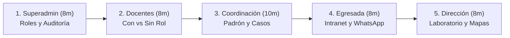

# PUKLLA EN RED — GUÍA DE AUDITORÍA MANUAL Y RECORRIDO FUNCIONAL
## Entorno de Ensayo Local · EESP Pukllasunchis

**Institución:** Escuela de Educación Superior Pedagógica Pukllasunchis (Cusco, Perú)  
**Proyecto:** Puklla en Red — Sistema de Seguimiento, Acompañamiento y Desarrollo Profesional de Egresados  
**Repositorio:** `JesusDjm2/Pukllasunchis`  
**Rama Oficial:** `sistemadeseguimientodeegresados`  
**Dirección Local del Sistema:** `http://127.0.0.1:8000`  
**Fecha:** 31 de Octubre de 2026  

---

### 1. SERVICIOS Y CONFIGURACIÓN LOCAL ACTIVA

Para que la aplicación opere con normalidad, deben permanecer activos los siguientes servicios:
1. **Motor de Base de Datos MySQL:** Activo localmente en puerto `3306` (Base de datos institucional de ensayo `pukllasunchis`).
2. **Servidor HTTP Laravel:** Activo en `http://127.0.0.1:8000` (`php artisan serve --port=8000`).
3. **Compilación Frontend:** Activos compilados con Vite en `public/build/` (CSS/JS).

> [!NOTE]
> Para detener el servidor Laravel: presiona `Ctrl + C` en la terminal o detén el proceso correspondiente.  
> Para volver a iniciarlo en cualquier momento:
> ```bash
> cd /Users/pavelchaparro/.gemini/antigravity/scratch/Pukllasunchis
> php artisan serve --port=8000
> ```

---

### 2. CREDENCIALES DE ENSAYO PARA AUDITORÍA

Se han aprovisionado seis perfiles sintéticos institucionales seguros.  
**Contraseña unificada para todas las cuentas de ensayo:** `Puklla2026!Auditor`

| # | Perfil Institucional | Correo de Acceso | Rol Spatie | Destino Post-Login | Propósito de Evaluación |
|:---:|:---|:---|:---|:---|:---|
| **1** | **Superadministrador** | `auditor.superadmin@puklla.test` | `super-admin` | `/admin` | Gestión de identidades, roles, píldora granate y tabla forense. |
| **2** | **Docente c/ Seguimiento** | `auditor.docente.seguimiento@puklla.test` | `docente`, `seguimiento-egresados` | `/docentes/272` | Verificación de sidebar, tarjeta granate y padrón de asignados. |
| **3** | **Docente Regular** | `auditor.docente.regular@puklla.test` | `docente` | `/docentes/273` | Comprobar que el dashboard ordinario permanece limpio e intacto. |
| **4** | **Coordinación Empleabilidad** | `auditor.coordinacion@puklla.test` | `coordinacion-empleabilidad`, `admin` | `/seguimiento-egresados` | Padrón general, grupos, campañas, WhatsApp y casos. |
| **5** | **Dirección General** | `auditor.direccion@puklla.test` | `direccion` | `/seguimiento-egresados/laboratorio` | Laboratorio analítico, mapas territoriales y exportaciones. |
| **6** | **Egresada Asignada** | `auditor.egresada@puklla.test` | `egresado` (`condicion=Egresado`) | `/egresado` | Ficha propia, historial laboral y enlace de actualización. |
| **—** | *Egresado No Asignado* | `egresado.noasignado@puklla.test` | `egresado` (ID 2120) | `/egresado` | Control negativo: probar que el docente recibe HTTP 403 al intentar verlo. |

---

### 3. SECUENCIA RECOMENDADA DE AUDITORÍA (30–45 MINUTOS)



#### Etapa 1: Superadministrador (Panel de Identidades y Auditoría)
1. Inicia sesión como `auditor.superadmin@puklla.test`.
2. Revisa la pestaña de docentes y haz clic en editar en un usuario (`/admin/edit/273`).
3. Observa la píldora granate `Seguimiento Egresados` (`.rp-seguimiento`).
4. Asigna o revoca el rol y guarda.
5. Verifica cómo se preservan los roles existentes (`docente`) sin destruirlos.

#### Etapa 2: Comparativa de Dashboards Docentes
1. Inicia sesión como Docente Regular (`auditor.docente.regular@puklla.test`).
   - Verifica que **no** aparece "Seguimiento de Egresados" en la barra lateral ni en la tarjeta principal.
   - Comprueba que sus cursos y funciones académicas están disponibles.
   - Intenta forzar la URL `http://127.0.0.1:8000/seguimiento-egresados`: confirma que el servidor responde `HTTP 403 Forbidden`.
2. Inicia sesión como Docente con Seguimiento (`auditor.docente.seguimiento@puklla.test`).
   - Verifica que en la barra lateral aparece la opción institucional con ícono granate.
   - Observa la tarjeta destacada en el dashboard.
   - Haz clic para entrar a Puklla en Red.

#### Etapa 3: Gestión del Seguimiento (Padrón, Asignaciones y Casos)
1. Estando como Docente con Seguimiento o como Coordinación:
   - Revisa el padrón institucional de egresados.
   - Como Docente con Seguimiento: observa que **únicamente** ves a tu egresada asignada (`Ana María Cusihuamán`).
   - Intenta consultar el expediente no asignado (`/seguimiento-egresados/episodios/2120`) y verifica el bloqueo `HTTP 403`.
2. Inicia sesión como Coordinación (`auditor.coordinacion@puklla.test`):
   - Consulta el universo completo de egresados.
   - Abre la pestaña de "Grupos de entrevistadores" y visualiza las asignaciones activas.
   - Prueba el modal de registro de actualización y registro de llamadas.

#### Etapa 4: Experiencia del Egresado
1. Inicia sesión como Egresada (`auditor.egresada@puklla.test`):
   - Ingresa a su intranet propia (`/egresado`).
   - Observa el botón institucional "Mi Historia Laboral — Puklla en Red".
   - Haz clic y comprueba que solo visualiza su propia ficha.
2. Prueba de Enlace Público de Campaña WhatsApp (Fase 1C):
   - Abre en una pestaña de incógnito:  
     `http://127.0.0.1:8000/seguimiento-egresados/campana/PKL-61834c9bbd76121aa3517e59799b256d81396c13e70a`
   - Verifica que el formulario carga con el desafío seguro de verificación y preservación longitudinal.

#### Etapa 5: Laboratorio de Inteligencia y Observatorio Territorial
1. Inicia sesión como Dirección General (`auditor.direccion@puklla.test`):
   - Accede directamente a `/seguimiento-egresados/laboratorio`.
   - Revisa la matriz cruzada de situación laboral vs programa.
   - Comprueba la aplicación de privacidad estadística (supresión de celdas pequeñas).
   - Explora el Observatorio Territorial con desglose por provincias del Cusco.
   - Prueba el botón de exportación CSV auditable.

---

### 4. MATRIZ DE NAVEGACIÓN Y ESTADO DE FUNCIONALIDADES

| Pantalla / Módulo | URL Local Exacta | Perfil Necesario | Acción a Realizar | Resultado Esperado | Estado |
| :--- | :--- | :--- | :--- | :--- | :---: |
| **Inicio de Sesión** | `/login` | Cualquier perfil | Ingresar correo y contraseña | Redirección contextual al dashboard correspondiente al rol. | **Funcional** |
| **Panel de Usuarios** | `/admin` | Superadministrador | Filtrar usuarios por roles | Pestañas con conteos reales de estudiantes FID, PPD, docentes y admins. | **Funcional** |
| **Edición de Roles** | `/admin/edit/272` | Superadministrador | Marcar/desmarcar `seguimiento-egresados` | Píldora granate seleccionable; guardado transaccional y evento en auditoría. | **Funcional** |
| **Dashboard Docente c/ Rol** | `/docentes/272` | Docente c/ Seguimiento | Inspeccionar menú lateral y tarjeta | Botón "Seguimiento de Egresados — Puklla en Red" visible con acceso directo. | **Funcional** |
| **Dashboard Docente Regular** | `/docentes/273` | Docente Regular | Inspeccionar dashboard | Menú lateral ordinario intacto, sin presencia del módulo de seguimiento. | **Funcional** |
| **Padrón de Egresados (Docente)** | `/seguimiento-egresados` | Docente c/ Seguimiento | Revisar lista de egresados | Solo muestra a los egresados asignados en grupos activos y campañas vigentes. | **Funcional** |
| **Padrón General (Coordinación)** | `/seguimiento-egresados` | Coordinación | Búsqueda, filtros y cohortes | Padrón completo institucional con historial longitudinal de episodios. | **Funcional** |
| **Expediente Egresado Asignado** | `/seguimiento-egresados/episodios/2119` | Docente c/ Seguimiento | Consultar episodios laborales | HTTP 200: modal o JSON con historial íntegro de empleos. | **Funcional** |
| **Control Perimetral 403** | `/seguimiento-egresados/episodios/2120` | Docente c/ Seguimiento | Consultar egresado no asignado | HTTP 403 Forbidden: bloqueo perimetral sin fuga de información. | **Funcional** |
| **Registro de Entrevistas** | `/seguimiento-egresados` | Coordinación / Docente | Pulsar "Actualizar" en egresado | Formulario modal con validación de empleos vigentes vs históricos. | **Funcional** |
| **Grupos de Entrevistadores** | `/seguimiento-egresados#grupos` | Coordinación | Visualizar cohortes asignadas | Listado de grupos, entrevistadores asignados y estado de campaña. | **Funcional** |
| **Generador Enlace WhatsApp** | `/seguimiento-egresados#whatsapp` | Coordinación | Generar link con token | Enlace seguro con token criptográfico de alta entropía. | **Funcional** |
| **Intranet de Egresada** | `/egresado` | Egresada Asignada | Consultar cuenta | Tarjeta "Puklla en Red" para acceder a la actualización de su historia laboral. | **Funcional** |
| **Formulario Público de Campaña** | `/seguimiento-egresados/campana/{token}` | Público / Egresada | Completar encuesta con token | Validación de token, confirmación sin cambios o adición de episodios. | **Funcional** |
| **Laboratorio Analítico** | `/seguimiento-egresados/laboratorio` | Dirección | Explorar métricas e indicadores | Matrices cruzadas, tasas de empleabilidad y análisis longitudinal. | **Funcional** |
| **Observatorio Territorial** | `/seguimiento-egresados/laboratorio` | Dirección | Revisar distribución geográfica | Agrupación por provincias del Cusco y zonas de intervención institucional. | **Funcional** |
| **Exportación CSV** | `/seguimiento-egresados/analitica/exportar` | Dirección | Descargar dataset analítico | Archivo CSV con metadatos institucionales y cero fuga de PII. | **Funcional** |
| **Creación Visual de Campañas** | `/seguimiento-egresados` | Coordinación | Crear nueva campaña desde UI | *Pendiente para Fase Posterior* (actualmente gestionado por BD/Eloquent). | **Pendiente** |
| **Notificaciones In-App Docente** | `/docentes/{id}` | Docente | Campana de avisos automáticos | *Pendiente para Fase Posterior* (se notificará asignación de nuevas cohortes). | **Pendiente** |

---

### 5. REGISTRO DE OBSERVACIONES DE AUDITORÍA

Para documentar cualquier discrepancia, duda o propuesta durante la navegación, utiliza la plantilla ubicada en:
[`docs/seguimiento-egresados/REGISTRO-OBSERVACIONES-AUDITORIA.md`](file:///Users/pavelchaparro/.gemini/antigravity/scratch/Pukllasunchis/docs/seguimiento-egresados/REGISTRO-OBSERVACIONES-AUDITORIA.md).
