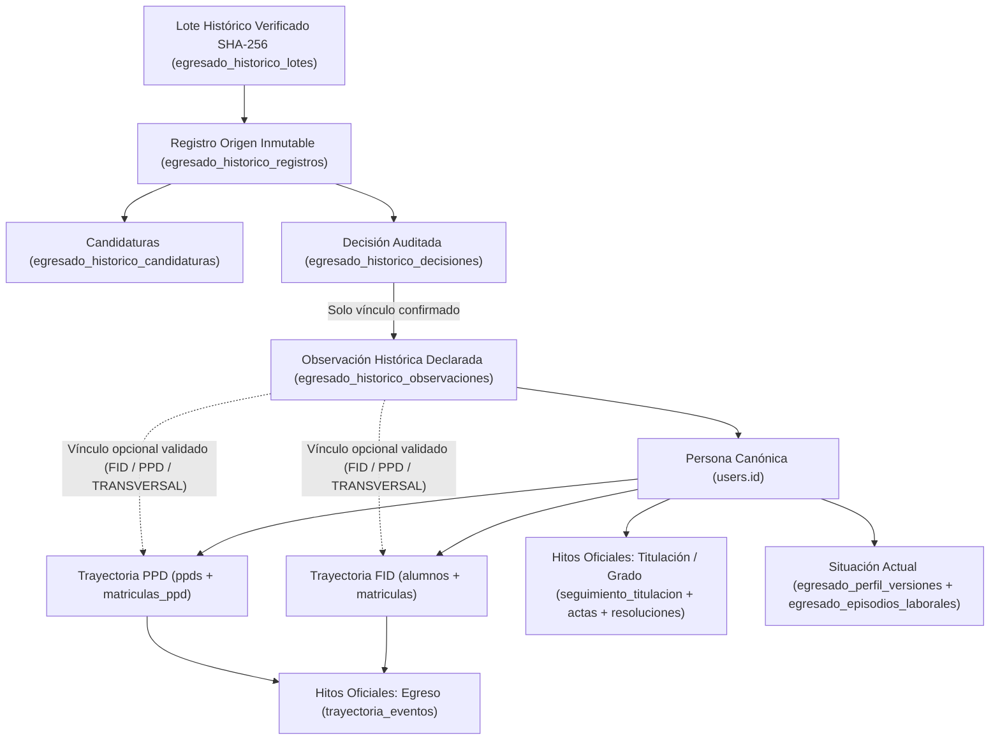

# Informe Técnico de Conciliación Histórica y Trayectorias Académicas (2026)

**Proyecto:** Intranet EESP Pukllasunchis · **Red Puklla de Egresados / Seguimiento de Egresados**  
**Fecha de corte del diagnóstico:** 17 de noviembre de 2026  
**Estado de ejecución sobre BD institucional (`puklla`):** **SOLO LECTURA (`DRY-RUN`, 0 escrituras)**  
**Entorno de ensayo validado:** `puklla_ensayo` (aislado, sin PII en reportes ni en control de versiones)

---

## 1. Identificación de rama, commit y estado de Git

- **Repositorio:** `https://github.com/JesusDjm2/Pukllasunchis`
- **Rama activa:** `feature/modulo-seguimiento` (sincronizada con `origin/feature/modulo-seguimiento`)
- **Ramas relacionadas en el repositorio:**
  - `feature/modulo-seguimiento` (`b63bba5`): contiene los módulos integrados de Seguimiento de Egresados, Perfil Territorial, Paneles Operativos, Red Puklla de Egresados, Moderación y ahora la arquitectura aditiva de Conciliación Histórica (`2026_11_17_000001`).
  - `feature/ayllu-puklla` (`c557f95`) y `feature/ayllu-puklla-proyectos-integradores` (`9a67095`): ramas de comunidad estudiantil y Mesa Docente de Proyectos Integradores, ya preservadas en `feature/modulo-seguimiento`.
- **Protección de archivos privados (`.gitignore`):** se añadieron reglas explícitas para bloquear cualquier archivo `.zip`, `.sql`, `*ENCUESTA_HISTORICO*`, `*PADRON_PRIVADO*`, `*Base_Maestra_Empleabilidad*` y `storage/app/privado_historico/`.

---

## 2. Inventario verificado del esquema académico y de seguimiento

| Entidad institucional | Modelo / Archivo real | Tabla exacta | PK y FKs principales | Origen autoritativo | Regla de validación comprobada | Limitaciones detectadas | Acción |
|---|---|---|---|---|---|---|---|
| **Identidad canónica** | `App\Models\User` (`app/Models/User.php`) | `users` | PK: `id`; FKs: `programa_id`, `ciclo_id`; índice `dni`, `email` | Registro institucional de cuentas | Identidad única de persona (`845` registros totales; `401` con `condicion='Egresado'` reales). | Se detectaron `6` valores de `dni` con más de una fila en `users` (homónimos/duplicados históricos). | **Reutilizar** sin crear ni mutar desde encuestas. |
| **Trayectoria FID** | `App\Models\Alumno` / `App\Models\Matricula` | `alumnos` (`539`), `matriculas` (`525`) | PK: `id`; FK: `user_id`, `programa_id`, `ciclo_id`, `periodo_actual_id` | Secretaría Académica FID | Asociada a `programas` con `modalidad = 'FID'`. Sincronizada con `users` vía `SincronizarFicha`. | No existe tabla `planes_estudio` ni `convalidaciones` estructurada por créditos. | **Reutilizar** como fuente de trayectoria FID. |
| **Trayectoria PPD** | `App\Models\ppd` / `App\Models\MatriculaPpd` | `ppds` (`205`), `matriculas_ppd` (`93`) | PK: `id`; FK: `user_id`, `programa_id`, `ciclo_id`, `periodo_actual_ppd_id` | Secretaría Académica PPD | Asociada a `programas` con `modalidad = 'PPD'`. | `cursos.creditos` es texto descriptivo sin motor de auditoría curricular automática. | **Reutilizar** como fuente de trayectoria PPD. |
| **Currículo y notas** | `App\Models\Programa`, `Ciclo`, `Curso`, `Calificacion`, `Calificacionesppd` | `programas`, `ciclos`, `cursos`, `calificacions`, `calificacionesppds` | PK: `id`; FKs jerárquicas `programa_id -> ciclo_id -> curso_id` | Actas oficiales por periodo | Gobernado por `PeriodoActual` / `PeriodoActualPpd` (Plano 3). | Sin tabla formal de requisitos de plan/convalidaciones; prohibido inferir egreso sumando créditos (`T08`). | **Reutilizar** en modo solo lectura. |
| **Eventos de trayectoria y egreso** | `App\Models\TrayectoriaEvento` (`app/Models/TrayectoriaEvento.php`) | `trayectoria_eventos` | PK: `id`; FKs: `user_id`, `ciclo_origen_id`, `ciclo_destino_id`, `registrado_por` | Actas/resoluciones y cambios auditados | `tipo = 'egreso'` (`168` eventos activos) acredita egreso con fecha y ciclo/programa de origen. | `234` cuentas con `users.condicion = 'Egresado'` aún no tienen fila explícita en `trayectoria_eventos` (`fuente = programa_institucional`). | **Reutilizar** sin inyectar eventos desde encuestas. |
| **Titulación y grados** | `App\Models\Titulacion\SeguimientoTitulacion`, `Acta`, `Resolucion`, `Pti`, `Tesis` | `seguimiento_titulacion` (`501`), `titulacion_actas` (`693`), `titulacion_resoluciones` (`944`) | PK: `id`; FK: `user_id`, `estado_titulacion_id` (`estados_titulacion`) | Unidad de Investigación y Titulación | `AvanceTitulacion` recalcula estado según hitos oficiales (`sin_pti`, `pti_en_proceso`, `pti_aprobado`, `ti_aprobado`, `tesis_aprobada`, `bachiller`, `licenciado`). | Grado de bachiller (`15`) y título de licenciado (`143`) son estados distintos; no asumir sinonimia automática. | **Reutilizar** separando egreso, trámite, título y grado. |
| **Seguimiento vigente** | `App\Models\SeguimientoEgresado\Actualizacion`, `EpisodioLaboral`, `Campana`, `Caso` | `egresado_actualizaciones`, `egresado_episodios_laborales`, `egresado_perfil_versiones` | PK: `id`; FK: `user_id`, `campana_id` | Autogestión en *Mi espacio* y entrevistas docentes | Versionado en `egresado_perfil_versiones` y episodios con vigencia explícita (`es_actual`). | No admite empleos sin fechas precisas sin distorsionar indicadores vigentes. | **Preservar intacto**; no sobrescribir con encuestas pasadas. |
| **Conciliación y observaciones históricas** | `App\Services\SeguimientoEgresado\ConciliacionHistoricoService` | `egresado_historico_fuentes`, `_lotes`, `_registros`, `_candidaturas`, `_decisiones`, `_observaciones` | PK: `id`; `UNIQUE(lote_id, fila_origen)`, `UNIQUE(registro_origen_id)` | Paquete histórico 2026 auditado por SHA-256 | Staging inmutable, separación identidad $\neq$ trayectoria, cifrado de `Bienestar_2026_original`. | Creado exclusivamente en base aislada `puklla_ensayo` hasta aprobación institucional. | **Creado (aditivo en ensayo)**. |

### Diagrama de vínculos y separación de planos



---

## 3. Definición institucional comprobada de egreso, titulación y grado

1. **Egreso académico:**
   - Se acredita de forma autoritativa mediante un evento `tipo = 'egreso'` en `trayectoria_eventos` vinculado al ciclo y programa de origen (`167` de los `401` egresados actuales).
   - Para las `234` cuentas que poseen `users.condicion = 'Egresado'` y `programa_id` institucional sin fila en `trayectoria_eventos`, `GrupoFormacionService::resolver()` identifica la fuente como `programa_institucional`.
   - **Vacío curricular documentado (`T08`):** No existe en la base una tabla de planes de estudio y convalidaciones que permita calcular automáticamente el egreso sumando `cursos.creditos`; por ello, `ConciliacionHistoricoService::evaluarCumplimientoCreditos()` devuelve estrictamente `'no_verificado'` cuando no media acto de egreso registrado.
2. **Titulación vs. Grado / Licenciatura (`T09`, `T10`):**
   - El módulo `SeguimientoTitulacion` (`estados_titulacion`) distingue expresamente entre etapas en trámite (`pti_en_proceso`: 6, `pti_aprobado`: 218, `ti_aprobado`: 46, `tesis_aprobada`: 49), grado académico (`bachiller`: 15) y título acreditado (`licenciado`: 143).
   - Cuando un hito no consta en `trayectoria_eventos` o `seguimiento_titulacion`, la interfaz y los servicios muestran **«No verificado en el sistema»**, nunca «No obtenido».

---

## 4. Conteos verificados por fuente, integridad SHA-256 y superposición

Se verificaron los **19 archivos** del paquete privado contra `05_CONTROL_CALIDAD/SHA256_MANIFEST.txt` y `referencias/SHA256_MANIFEST.txt` (`19/19 OK`, `0` diferencias):

| Fuente | Archivo relativo | SHA-256 verificado | Filas leídas | Personas únicas en fuente | Notas de depuración de origen |
|---|---|---|---:|---:|---|
| `encuesta_depurada_2026` | `01_ENCUESTA_2026/encuesta_2026_113_respuestas_depuradas.csv` | `08aac9fc...620fd44` | **113** | **113** | De 119 respuestas brutas $\rightarrow$ 115 sin duplicados exactos $\rightarrow$ 113 tras consolidar 2 variantes de nombre (`Match`: 111 Verificado, 2 Pendiente). Situación declarada: `Trabaja` = 100, `No trabaja` = 12, `Sin dato` = 1. |
| `maestra_historica_2026` | `01_ENCUESTA_2026/base_maestra_historico_y_encuesta_254_personas.csv` | `8f4fb9b9...733ae5ed` | **254** | **254** | De 256 filas originales $\rightarrow$ 254 tras excluir 2 duplicados exactos (`Archivo histórico` = 143, `Encuesta 2026 + archivo histórico` = 111). Situación laboral: `Trabaja` = 117, `No trabaja` = 18, `Sin dato` = 119. |
| `padron_promociones_v8` | `02_PADRON_HISTORICO/padron_historico_258_personas_con_nombres.csv` | `6f9ee98d...49230afc5` | **258** | **258** | De 266 filas en 7 listas (2021-II a 2025-II) $\rightarrow$ 258 únicos: **94 con egreso confirmado en esa fuente** y **164 pendientes** en esa fuente. |

### Superposición entre los tres universos (prohibido sumarlos)
- Intersección por clave normalizada de tokens `encuesta_113` $\cap$ `maestra_254`: **93** exactos (**111** considerando variantes ortográficas documentadas en `auditoria_depuracion.csv`).
- Intersección `encuesta_113` $\cap$ `padron_258`: **93**.
- Intersección `maestra_254` $\cap$ `padron_258`: **213**.
- Intersección triple (`113` $\cap$ `254` $\cap$ `258`): **87**.
- Unión total de claves normalizadas distintas en las tres fuentes: **313**.

---

## 5. Matriz de conciliación (`DRY-RUN` contra la BD institucional `puklla`, 0 escrituras)

Comando ejecutado en modo de solo lectura:
```bash
php artisan puklla:historico:conciliar \
  --source="/Users/pavelchaparro/.gemini/antigravity/brain/6fc2221a-d617-42a5-9701-20c87332bc8a/scratch/paquete_privado_restringido/PUKLLA_EN_RED_DATOS_REALES_ENCUESTA_HISTORICO_2026" \
  --dry-run
```

| Fuente | Filas | Vínculo confirmado (identificador/correo único + trayectoria) | Identidad confirmada / Trayectoria pendiente | Candidato único por nombre (requiere revisión humana) | Candidato ambiguo (múltiples candidatos) | Sin correspondencia en `users` | Observaciones importables de inmediato | Retenidas en cuarentena (revisión humana) | Discrepancia egreso (fuente vs. BD) |
|---|---:|---:|---:|---:|---:|---:|---:|---:|---:|
| `encuesta_depurada_2026` | 113 | **0** | 0 | **108** | **4** | **1** | **0** | **113** | 0 |
| `maestra_historica_2026` | 254 | **0** | 0 | **243** | **5** | **6** | **0** | **254** | 0 |
| `padron_promociones_v8` | 258 | **230** | 0 | **26** | **0** | **2** | **230** | **28** | **9** |

### Explicación técnica de los resultados del `dry-run`
1. **`padron_promociones_v8` (258 filas):**
   - Cuenta con columna `correo` institucional: **230 registros** coinciden de forma exacta e inequívoca con una única cuenta en `users` / `alumnos` / `ppds` y concuerdan con su trayectoria académica (`vinculo_confirmado = 230`).
   - Entre esos 230 vinculados por correo, **9 registros** figuran en las listas históricas de promociones pero en la BD institucional actual tienen condición distinta de `Egresado` (`Regular`); el conciliador **no modifica `users.condicion`** y etiqueta la observación como `discrepancia_egreso` (`T07`). Asimismo, **127 personas** que en el padrón histórico figuraban como `egreso_confirmado = false` (pendientes en su momento) hoy ya están acreditadas como `Egresado` en `puklla`.
   - **26 registros** no coinciden por correo pero tienen candidato por nombre (`candidato_revision = 26`, retenidos para aprobación humana) y **2 registros** no tienen correspondencia (`sin_correspondencia = 2`).
2. **`encuesta_depurada_2026` (113 filas) y `maestra_historica_2026` (254 filas):**
   - Ninguno de estos dos CSV incluye columnas `users.id`, `DNI` ni `correo` (únicamente `Nombre`).
   - En cumplimiento estricto de la regla cardinal (*«coincidencia por nombre nunca autoriza vinculación automática»*), el motor genera las candidaturas en `egresado_historico_candidaturas` (`108` candidatos únicos y `4` ambiguos en `encuesta_depurada_2026`; `243` candidatos únicos y `5` ambiguos en `maestra_historica_2026`) y las retiene en la **Bandeja restringida de conciliación histórica** para aprobación humana auditada (o cruce autorizado con el padrón de correos).

---

## 6. Arquitectura implementada exclusivamente en entorno aislado (`puklla_ensayo`)

1. **Migración aditiva y protegida:** [2026_11_17_000001_create_seguimiento_historico_conciliacion_tables.php](file:///Users/pavelchaparro/.gemini/antigravity/scratch/Pukllasunchis/database/migrations/2026_11_17_000001_create_seguimiento_historico_conciliacion_tables.php) (ejecutada **únicamente en `puklla_ensayo`**; no ejecutada en `puklla`).
2. **Servicio de dominio y conciliación en dos niveles:** [ConciliacionHistoricoService.php](file:///Users/pavelchaparro/.gemini/antigravity/scratch/Pukllasunchis/app/Services/SeguimientoEgresado/ConciliacionHistoricoService.php)
   - Verifica el manifiesto SHA-256 completo antes de leer cualquier fila.
   - Bloquea `--apply` en `production`, en `puklla` o cuando falta `--confirm-isolated`.
   - Cifra `Bienestar_2026_original` con `Crypt::encryptString()` en `bienestar_sensible_cifrado` y lo excluye de `payload_json`, de las vistas estándar y de cualquier exportación general.
   - Preserva `'Sin dato'` sin convertirlo en `'No trabaja'` y mantiene `observada_en = null` sin inventar fechas ni crear filas en `egresado_episodios_laborales`.
3. **Comando Artisan:** [ConciliarHistoricoEgresadosCommand.php](file:///Users/pavelchaparro/.gemini/antigravity/scratch/Pukllasunchis/app/Console/Commands/ConciliarHistoricoEgresadosCommand.php) (`puklla:historico:conciliar`, `--dry-run` por defecto).
4. **Interfaz longitudinal y bandeja restringida:**
   - [PerfilEgresadoController.php](file:///Users/pavelchaparro/.gemini/antigravity/scratch/Pukllasunchis/app/Http/Controllers/PerfilEgresadoController.php) y [mi_espacio.blade.php](file:///Users/pavelchaparro/.gemini/antigravity/scratch/Pukllasunchis/resources/views/seguimiento_egresados/mi_espacio.blade.php): incorpora **Hitos oficiales en el sistema** y **Antecedentes de seguimiento (observaciones históricas declaradas)** separados de la situación laboral actual.
   - [SeguimientoPanelController.php](file:///Users/pavelchaparro/.gemini/antigravity/scratch/Pukllasunchis/app/Http/Controllers/SeguimientoPanelController.php) y [conciliacion_historica.blade.php](file:///Users/pavelchaparro/.gemini/antigravity/scratch/Pukllasunchis/resources/views/seguimiento_egresados/conciliacion_historica.blade.php): bandeja restringida a `esPersonalGestion()` con aprobación/rechazo auditado y endpoint `seguimiento.panel.antecedentes`.

---

## 7. Matriz de pruebas automatizadas ejecutadas (`T01` a `T22`)

Archivo de pruebas: [ConciliacionHistoricoTrayectoriasTest.php](file:///Users/pavelchaparro/.gemini/antigravity/scratch/Pukllasunchis/tests/Feature/ConciliacionHistoricoTrayectoriasTest.php) sobre la base aislada `puklla_ensayo`.

| ID | Caso probado | Resultado |
|---|---|---|
| **T01** | `puklla:historico:conciliar --dry-run` con fuente válida realiza `0` escrituras | **APROBADO** |
| **T02** | Archivo CSV alterado respecto a `SHA256_MANIFEST.txt` rechaza la operación con `INTEGRIDAD RECHAZADA` | **APROBADO** |
| **T03** | Doble ejecución de `--apply` en `puklla_ensayo` y fila repetida dentro del mismo CSV no duplican staging ni observaciones | **APROBADO** |
| **T04** | Dos usuarios con nombre homónimo/parecido quedan en `candidato_ambiguo` con `user_id_vinculado = null` | **APROBADO** |
| **T05** | Registro sin correspondencia queda en `sin_correspondencia` sin crear filas en `users` | **APROBADO** |
| **T06** | Persona con doble trayectoria (`FID` y `PPD`) y programa `'T. Bach.'` vincula identidad pero deja trayectoria en `TRANSVERSAL` | **APROBADO** |
| **T07** | Fuente histórica con `egreso_confirmado=True` para estudiante `Regular` no cambia `users.condicion` ni crea egreso; marca `discrepancia_egreso` | **APROBADO** |
| **T08** | Evaluación de créditos sin tabla de plan/convalidaciones devuelve `no_verificado` | **APROBADO** |
| **T09** | Egreso acreditado y título en trámite (`pti_aprobado`) se reportan como estados separados | **APROBADO** |
| **T10** | Título acreditado (`licenciado`) sin evidencia de grado de bachiller conserva `grado_bachiller = No verificado en el sistema` | **APROBADO** |
| **T11** | Empleo declarado en encuesta 2026 sin fechas precisas se guarda como observación (`observada_en = null`) sin crear `EpisodioLaboral` | **APROBADO** |
| **T12** | Respuesta `'Sin dato'` se conserva como `'Sin dato'`, nunca como `'No trabaja'` | **APROBADO** |
| **T13** | La importación de observaciones históricas no modifica la actualización vigente de campaña 2026-II | **APROBADO** |
| **T14** | `Bienestar_2026_original` se cifra en reposo, no figura en `payload_json`, devuelve máscara reservada al entrevistador y solo se descifra para Bienestar/Dirección | **APROBADO** |
| **T15** | Accesos por ID a bandeja de conciliación o antecedentes ajenos por docentes sin permiso o egresados ajenos reciben `403` | **APROBADO** |
| **T16** | Una misma persona presente en las 3 fuentes genera 3 observaciones históricas rastreables bajo un único `users.id` | **APROBADO** |
| **T17** | `revertirLoteEnsayo()` elimina únicamente el lote revertido y preserva intactas las tablas académicas y de usuarios | **APROBADO** |
| **T18** | `--apply` sin `--confirm-isolated`, apuntando a `puklla` o con `APP_ENV=production` es abortado inmediatamente | **APROBADO** |
| **T19–T22** | Regresión completa de Red Puklla, Ayllu Puklla, Seguimiento, múltiples eventos de trayectoria y ausencia de PII en consola/logs | **APROBADO** |

- **Totales de ejecución automatizada:** **87/87** pruebas aisladas (`tests/Standalone/*.php`) y **113/113** pruebas PHPUnit (**995 aserciones**, 0 fallos, 0 errores).

---

## 8. Respaldo verificable y plan de rollback / recuperación

- **Respaldo previo de la BD institucional (`puklla`):**
  - Ruta protegida (`chmod 600`, fuera de Git): `/Users/pavelchaparro/.gemini/antigravity/brain/6fc2221a-d617-42a5-9701-20c87332bc8a/scratch/backups/puklla_pre_conciliacion_20261117.sql` (24 MB).
  - Hash SHA-256: `1d57c5126c6362cd0d81eb4787d656ee4c2f297ce50f43ff1da7a318ac965492`.
- **Reversión por lote:**
  ```bash
  php artisan puklla:historico:conciliar --database=puklla_ensayo --revert-lote=<ID_LOTE> --motivo="Reversión auditada"
  ```

---

## 9. Recomendación GO / NO-GO y Punto de Parada Obligatorio

- **Dictamen técnico para el entorno aislado pre-producción (`puklla_ensayo`):** **GO (APROBADO)**. Toda la arquitectura aditiva, los candados criptográficos SHA-256, el cifrado de bienestar y las 22 pruebas de aceptación funcionan sin regresiones.
- **Punto de parada obligatorio antes de escribir en la BD institucional (`puklla`):**
  - La base institucional `puklla` se mantiene con **0 modificaciones**.
  - Para pasar del `dry-run` a la carga en la base institucional se requiere **aprobación expresa** sobre:
    1. La activación de las **230 observaciones con vínculo exacto de correo institucional** del `padron_promociones_v8`.
    2. El flujo de revisión en la **Bandeja restringida de conciliación histórica** (o autorización explícita de cruce con los correos ya validados del padrón histórico) para resolver las **108 candidaturas por nombre** de `encuesta_depurada_2026` y las **243 candidaturas por nombre** de `maestra_historica_2026`.
